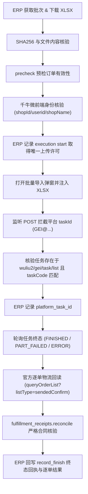

# 畔色 ERP 淘宝批量发货执行器安装与操作指南

## 一、模块概述与核心业务链路

本程序 (`scripts/fulfillment_batch_runner.py`) 负责消费 ERP 后台已生成的发货批次，驱动已登录千牛卖家后台的专用 Edge 浏览器完成官方批量发货，并严格按照官方物流回执核对每单结果写回 ERP。

### 核心执行链路：


> [!IMPORTANT]
> **单笔订单也必须严格走批量发货入口**：
> 官方 `https://qn.taobao.com/home.htm/batch-consign` 批量发货模板支持 1 至 2000 单。单笔发货与多笔发货保持一致的批量导入流程与完整的任务审计追踪，严禁绕开批量入口进行单笔网页模拟点击。

---

## 二、运行环境与依赖配置

### 1. Python 环境
- Python 3.11+
- 安装依赖：
  ```bash
  pip install -r requirements-fulfillment.txt
  ```

### 2. 专用浏览器 (千牛 Edge)
- 程序通过 Chrome DevTools Protocol (CDP) 连接已登录的千牛浏览器。
- 端口探测文件：`..\..\..\Web-Agent程序\data\profiles\campaign-edge-dedicated-v1\DevToolsActivePort`。
- 启动脚本已修正为上探三级目录，可自动读取并解析动态端口；亦可通过环境变量显式指定：
  ```bash
  set PANSE_SHIPPING_CDP_URL=http://127.0.0.1:57742
  ```

### 3. 操作员会话认证
- 严格遵循安全守则：程序**绝不自动生成或打印管理员令牌**。
- 操作员需在执行前提供有效的 `PANSE_API_TOKEN`：
  ```bash
  set PANSE_API_TOKEN=your_token_here
  ```

### 4. 平台任务编号兼容性
- ASCP 平台真实任务编号包含 `@` 分隔符（如 `GEI@consign2_batch_offline_consign@261121145759@3798`）。
- 后端校验正则已全局统一支持：`r'^[A-Za-z0-9_@-]{1,64}$'`。

---

## 三、原批次执行与收口事实 (严禁重复建批次与重复上传)

针对原真实批次：
- **批次 ID (UUID)**: `32e6d617-f609-4f92-90c3-45ca675fab7f`
- **对应店铺**: `畔色木作` (`shopId: 431991266`, `userid: 2215699812811`, `nick: tb697331180593`)
- **主订单号**: `5127439575180167827`
- **承运商**: `圆通速递`
- **运单号**: `YT2551171304891`
- **实物事实与执行历史**:
  - 用户确认订单对应的 3 块木样已实际交运圆通。
  - **平台执行确认**: 于 2026-11-21 14:57:59 通过千牛批量发货导入上传，平台生成受理任务编号 `GEI@consign2_batch_offline_consign@261121145759@3798`，并在 14:58:01 执行完毕（`FINISHED`，成功 1 单、失败 0 单）。
  - **物流与交易状态**: 官方包裹编码 `LP00856480103183`，物流公司 `圆通速递`，单号 `YT2551171304891`；千牛官方交易状态已由待发货转变为 `WAIT_BUYER_CONFIRM_GOODS`（商家已发货，等待买家确认），买家自动确认收货倒计时已启动。
  - **ERP 原批次回执补齐**: 生产库原处于 `prepared` 状态的批次已按“平台已执行、ERP漏记”规范，补录对账回执收口为 `confirmed`，intake 状态收口为 `confirmed`，严格保留原始平台凭证与时间戳审计依据。
  - **防重复验证**: 原批次再次调用启动时，程序识别终态直接返回 `already_confirmed`，不会触发任何浏览器连接或再次上传。
- **文件校验**: XLSX 文件大小 3573 字节，SHA256 为 `ee90218dfe6915161846b7dc39edf03bb05b37d99482d4c0786df99f515e0cda`。

---

## 四、启动命令与运行方式

### 方式 1：只读演练测试 (`--dry-run`)
此模式仅读取 ERP 批次、核对文件 SHA256 与订单行，**不连接浏览器、不上传文件、不写业务状态**：

```bat
# Windows CMD
set PANSE_API_TOKEN=your_token_here
scripts\run_batch_shipping.bat --batch-id 32e6d617-f609-4f92-90c3-45ca675fab7f --dry-run
```

```powershell
# PowerShell
$env:PANSE_API_TOKEN = "your_token_here"
.\scripts\run_batch_shipping.ps1 -BatchId 32e6d617-f609-4f92-90c3-45ca675fab7f -DryRun
```

### 方式 2：正式实单发货提交
完成预检并经操作员确认后执行实单发货：

```bat
# Windows CMD
set PANSE_API_TOKEN=your_token_here
scripts\run_batch_shipping.bat --batch-id 32e6d617-f609-4f92-90c3-45ca675fab7f
```

```powershell
# PowerShell
$env:PANSE_API_TOKEN = "your_token_here"
.\scripts\run_batch_shipping.ps1 -BatchId 32e6d617-f609-4f92-90c3-45ca675fab7f
```

---

## 五、关键安全防护与容灾机制

> [!IMPORTANT]
> 1. **唯一上传许可机制 (Single-Start Guard)**
>    批次首次执行时调用 `record_start`，仅在平台返回 `upload_allowed: True` 时才生成临时 XLSX 进行上传；若发生网络中断或丢失响应，批次自动锁定为 `submitting` 保护状态，**绝不重传**。
>
> 2. **断线恢复机制 (Disconnect Recovery)**
>    若程序在上传后与浏览器断开，再次以同批次 ID 启动时：
>    - 检测到 `platform_task_id` 已存在，**直接跳过 `upload_and_submit`**；
>    - 在千牛平台官方任务列表核对原 `taskId`，继续轮询终态并逐单核验；
>    - 若平台无法找到原任务，程序报错终止并保留原占位，禁止改用其他任务或重新上传。
>
> 3. **超时保护 (Timeout Safety)**
>    轮询平台任务超过 `max_poll_sec`（默认 300 秒）未达到终态时，任务状态标记为 `EXECUTING (timeout)`，对账逻辑输出 `unknown`，批次保持原有 `platform_task_id`，等待人工或后续查询，严禁重复提交。
>
> 4. **重复启动幂等 (Duplicate Launch Protection)**
>    若批次已处于 `confirmed` 终态，程序直接返回 `already_confirmed`，零浏览器操作、零业务写操作。
>
> 5. **ERP 订单状态解耦 (No Direct Shipped Mutation)**
>    本程序仅更新 `fulfillment_batches` 与 `fulfillment_intakes` 的批次流转状态，**绝不直接强写 `orders.status = 'shipped'`**。订单发货终态由 ERP 官方报表同步机制统一驱动。

---

## 六、测试验证与实单验收报告

| 测试类别 | 验证范围 | 状态 | 详细说明 |
| :--- | :--- | :--- | :--- |
| **单元与回归测试** | 4 个测试套件，共 129 项用例 | **100% 通过** | 包括 `test_fulfillment_batch.py`、`test_fulfillment_batch_runner.py`、`test_fulfillment_execution_guards.py`、`test_fulfillment_intake_deadlines.py` |
| **真实实单回放测试** | 真实报文全链路回放 | **100% 通过** | `test_real_order_readback_playback_confirms_with_live_responses` 使用本次 5127439575180167827 真实 JSON 回放，reconcile 精准输出 confirmed |
| **负向防护测试** | 运单、物流公司、子单不匹配 | **100% 通过** | 验证不匹配数据严格保持 unknown，防止错误确认为成功 |
| **断线恢复与幂等测试** | 断线续接、重复启动、无任务保护 | **100% 通过** | 验证已有任务跳过上传、已确认批次返回 `already_confirmed` 零写操作、未知提交禁止重传 |
| **现场实单批量上传** | 真实订单批量发货提交 | **实单验收完成** | 任务 `GEI@consign2_batch_offline_consign@261121145759@3798` 在 2026-11-21 14:58:01 完成，1 成功 0 失败 |
| **逐单物流与交易回读** | 包裹生成与买家确认倒计时 | **实单验收完成** | 官方生成包裹 `LP00856480103183`，圆通速递 `YT2551171304891`，交易主状态 `WAIT_BUYER_CONFIRM_GOODS` |
| **ERP 批次回执对账** | 原批次生产库收口 | **实单验收完成** | 原批次 `32e6d617` 与 intake 均收口为 `confirmed`，完整保留原始回执与时间戳审计依据 |

> [!NOTE]
> **自动发货开关评估说明**:
> 生产环境业务开关环境变量为 `PANSE_BATCH_SHIPPING_ENABLED=1`（数值为 1，非 true）。目前实单证据已全部齐备、ERP 生产库原批次已收口、回读程序已自闭环、防重传机制均经实测验证。后续开启自动发货只需确保操作员会话 `PANSE_API_TOKEN` 有效配置。
